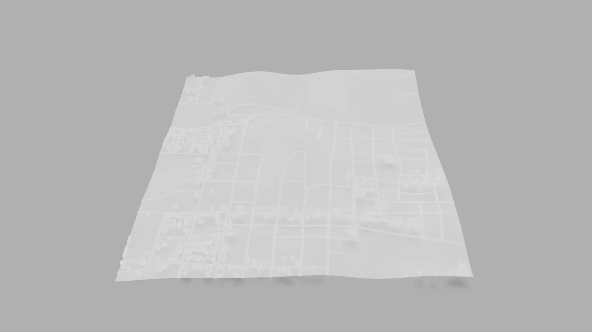

# Malha Urbana 3D — Teresina (v1)

Primeira versão do projeto: a malha urbana de Teresina (PI) em 3D, interativa no navegador.

<p align="center">
  <a href="https://hadassita.github.io/projetocartografia/">
    
  </a>
</p>

<p align="center">
  <a href="https://hadassita.github.io/projetocartografia/"><b>▶ Abrir a visualização</b></a>
</p>

> A versão mais nova, com o visualizador topográfico, está em
> **[projetocartografiav2](https://github.com/Hadassita/projetocartografiav2)**.

## Como usar

| Ação | Computador | Celular |
|---|---|---|
| Girar o modelo | arrastar com o botão esquerdo | arrastar com um dedo |
| Aproximar / afastar | rolar o mouse | movimento de pinça |
| Mover a vista | arrastar com o botão direito | arrastar com dois dedos |

## Tecnologias

- HTML e CSS
- [`<model-viewer>`](https://modelviewer.dev/) 3.4 (WebGL), com barra de carregamento
- Modelo 3D em glTF binário (`teresina.glb`)
- Publicação com GitHub Pages

## Estrutura

```
.
├── index.html     # página da visualização
├── teresina.glb   # modelo 3D da malha urbana
└── preview.webp   # imagem de prévia usada neste README
```

## Rodar localmente

```bash
git clone https://github.com/Hadassita/projetocartografia.git
cd projetocartografia
python -m http.server 8000
```

Depois, abra `http://localhost:8000` no navegador.

## Autora

**Hadassa Fontes** — Engenharia Mecânica, UFPI
